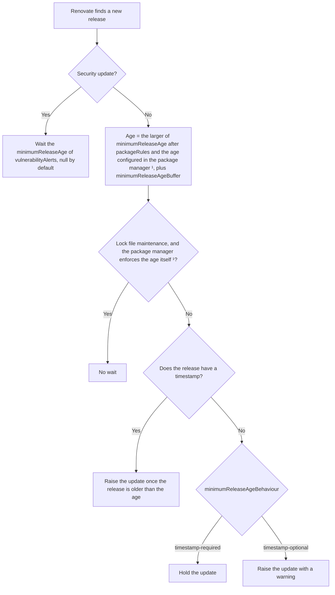

# Minimum Release Age

## What is Minimum Release Age?

`minimumReleaseAge` is a feature that requires Renovate to wait for a specified amount of time before suggesting a dependency update.

The use of `minimumReleaseAge` is not to slow down fast releasing project updates, but to provide a means to reduce risk supply chain security risks.

In other ecosystems and package managers, this may be referred to as a "dependency cooldown".

For example, `minimumReleaseAge=14 days` would ensure that a package update is not suggested by Renovate until 14 days after its release, which allows plenty of time to allow security researchers and automated security tools to catch malicious intent in packages.

Note: Renovate will wait for the set duration to pass for each **separate** version.
Renovate does not wait until the package has seen no releases for x time-duration(`minimumReleaseAge`).

When the time passed since the release is _less_ than the set `minimumReleaseAge`: Renovate adds a "pending" status check to that update's branch.
After enough days have passed: Renovate replaces the "pending" status with a "passing" status check.

## How long does Renovate wait?

This flowchart shows how Renovate decides how long to wait before it raises an update:



¹ Only with [`minimumReleaseAgePackageManagerSync`](../configuration-options.md#minimumreleaseagepackagemanagersync), for the managers in the [table of package managers](#my-package-manager-has-support-for-minimum-release-age-how-does-renovate-work-with-that-do-i-need-to-set-it-in-both).

## Configuration options

The following configuration options can be used to enable and tune the functionality of Minimum Release Age:

- [`minimumReleaseAge`](../configuration-options.md#minimumreleaseage) (previously known as `stabilityDays`)
- [`minimumReleaseAgeBehaviour`](../configuration-options.md#minimumreleaseagebehaviour)
- [`internalChecksFilter`](../configuration-options.md#internalchecksfilter)

### `minimumReleaseAgeBehaviour=timestamp-optional` warning

When Renovate runs with `minimumReleaseAgeBehaviour=timestamp-optional`, Renovate will log a warning, which is then also shown on the Dependency Dashboard.

This warning serves to inform users about at least one dependency not being able to adhere to the minimum release age due to the configuration.

In cases where this is not desired, you can remap the warning to a lower log level with [`logLevelRemap`](../configuration-options.md#loglevelremap):

```json
{
  "logLevelRemap": [
    {
      "matchMessage": "/Some .+ did not have a releaseTimestamp, but as we're running with minimumReleaseAgeBehaviour=timestamp-optional, proceeding/",
      "newLogLevel": "info"
    }
  ]
}
```

## FAQs

### Where does the release timestamp need to be set?

To prevent supply-chain attacks, Renovate requires that the registry/datasource provides the timestamp.

This ensures that a package maintainer cannot specify (maliciously or accidentally) a different timestamp to when the package was actually published.

!!! warning
  For instance, a suggestion for the Docker ecosystem is to use the `org.opencontainers.image.created` image annotation.
  <br>
  Unfortunately, the publisher controls this annotation, so could allow a maintainer to say that their image was published earlier than it had been to bypass Minimum Release Age restrictions.

As long as the registry/datasource provides the release timestamp, Renovate will add support for it.

### My package manager has support for minimum release age, how does Renovate work with that? Do I need to set it in both?

We recommend specifying minimum release age in **both** your Renovate and package manager configuration.

Renovate's concept of `minimumReleaseAge` is set independently to your package manager's configuration, and is used by Renovate to decide whether to suggest dependency updates.

When Renovate performs a dependency update, it may delegate to your package manager to update artifacts, such as the lockfile.
In some cases, this can lead to a transitive dependency being introduced, [which Renovate is not aware of](#what-happens-to-transitive-dependencies), and so could lead to a dependency being introduced without Renovate's `minimumReleaseAge` check being followed.

To protect against this, it is recommended to ensure that your package manager configuration includes the relevant minimum release age checks, too.

There is ongoing work to [integrate more closely with package manager checks](https://github.com/renovatebot/renovate/issues/41652) to make sure that Renovate's minimum release age configuration is specified when calling package managers that support it.
If you have a package manager you'd like supported, please raise a [Suggest an Idea Discussion](https://github.com/renovatebot/renovate/discussions/new?category=suggest-an-idea).

If you opt into the new, experimental behavior with the [`minimumReleaseAgePackageManagerSync`](../configuration-options.md#minimumreleaseagepackagemanagersync) feature flag, a manager may read the minimum release age from the configuration of your package manager.
If it does, Renovate uses the larger of that value and `minimumReleaseAge`.
Without `minimumReleaseAgePackageManagerSync`, Renovate does not read the minimum release age from the configuration of your package manager.

Renovate applies the value from your package manager per dependency, like a `packageRules` entry, so it does not hold back packages which your package manager excludes, or dependencies of other datasources.
Such an exclusion never lowers `minimumReleaseAge`.
Setting `minimumReleaseAge` to `null` does not turn off the value from the configuration of your package manager.

With `minimumReleaseAgePackageManagerSync`, the package managers in the table below receive the `minimumReleaseAge` of your repository or manager config, but not a larger `minimumReleaseAge` from `packageRules`.
A package manager applies the minimum release age to every package of the lock file, so a larger value for some updates, such as major updates, would fail on packages which other updates locked.
A `minimumReleaseAge` from `packageRules` still decides when Renovate raises an update.
Renovate never passes [`minimumReleaseAgeBuffer`](../configuration-options.md#minimumreleaseagebuffer) to the package manager.

Set [`minimumReleaseAgePackageManager`](../configuration-options.md#minimumreleaseagepackagemanager) at the top level or in a manager's config to set a lower bound for the value which Renovate passes to these package managers.
The `security:minimumReleaseAge*` presets set it for the manager of their datasource: `npm`, `cargo` or `poetry`.

An update whose own `minimumReleaseAge` is smaller, for example from `packageRules`, wins over the repository value and `minimumReleaseAgePackageManager` for its branch.
How Renovate does this depends on the package manager:

- pnpm excludes the updated versions
- Yarn preapproves the updated versions
- Poetry excludes an updated package only if its constraint pins a single version
- npm and cargo get the smaller value for that branch

The smaller value never wins over the minimum release age which your repository configures in the package manager itself.
The package manager still applies that age, like for security updates, and refuses a younger release.

Without `minimumReleaseAgePackageManagerSync`, a package manager which receives the minimum release age from Renovate gets the `minimumReleaseAge` of the update, including a value from `packageRules`, and `minimumReleaseAgePackageManager` has no effect.

The table below lists the managers with a known integration, per package manager.
Managers that are not listed do not integrate with the minimum release age of their package manager.

<!-- Autogenerate managerMinimumReleaseAgeSupport -->

#### npm

When `minimumReleaseAge` is configured, Renovate passes `--before=<date>` to npm commands during lock file generation.
This ensures that npm only resolves package versions that were available before the cooldown threshold, protecting against newly published (and potentially malicious) transitive dependencies.

The `--before` date is calculated as `now - minimumReleaseAge`.
If a `before=<date>` setting already exists in the project's `.npmrc`, Renovate uses the stricter (older) of the two dates.
If the project's `.npmrc` has a `min-release-age=<days>` setting, Renovate does not pass `--before`, as npm rejects both together, and npm applies the `min-release-age` itself.

If the existing lock file contains packages published after the `--before` cutoff (for example, from dependencies merged before `minimumReleaseAge` was configured), npm will fail with an `ETARGET` error.
In this case, Renovate automatically retries without `--before` and logs a warning.
This ensures existing lock files are never broken by the `--before` flag.

After the next lock file maintenance run (which regenerates the lock file from scratch with `--before`), subsequent updates will fully enforce the `minimumReleaseAge` constraint.

##### Default npm behavior

Renovate passes `--before` for the `minimumReleaseAge` of the update, including a value from `packageRules`, and does not read the `.npmrc` when it looks up updates.

For example, with `minimumReleaseAge` set to `7 days` in the `npm` config, and in `packageRules` to `30 days` for major updates and to `null` for `@types/node`, Renovate runs npm with `--before` set to 30 days ago for a major update, and without `--before` for the `@types/node` update.

##### npm with `minimumReleaseAgePackageManagerSync`

Renovate uses the `minimumReleaseAge` of the repository or `npm` manager config, not one from `packageRules`, as npm applies `--before` to every package of the lock file.
A larger `minimumReleaseAgePackageManager` raises it.
Lock file maintenance uses the larger of its own `minimumReleaseAge` and `minimumReleaseAgePackageManager`, and security updates do not pass `--before`.

If an updated npm package has a smaller `minimumReleaseAge` and its release is younger than that value or has no timestamp, Renovate uses the smaller value for `--before`, or passes no `--before` for `0`, and adds a notice to the PR.
A lowered `--before` also uses the older `before=<date>` of the `.npmrc`, and the notice names the `.npmrc` date if it applies.

Renovate also uses the larger of the `.npmrc` age and `minimumReleaseAge` when it looks up updates.
A `before=<date>` setting counts as the time elapsed since that date.

This applies to the npm dependencies of every `package.json` of the `npm` manager for which Renovate finds no Yarn or pnpm lock file, as Renovate then assumes npm.
For the minimum release age, Renovate uses the `.npmrc` next to the lock file or the `npmrc` config option, and not an `.npmrc` of a parent directory.

Lock file maintenance does not retry after an `ETARGET` error, and reports it as an artifact error instead.

npm enforces the minimum release age during lock file maintenance of a `package-lock.json` or `npm-shrinkwrap.json`, so Renovate creates the branch without waiting for release timestamps, if:

- Renovate passes `--before`, or the project's `.npmrc` has a `before=<date>` setting, or
- the project's `.npmrc` has a `min-release-age=<days>` setting of at least `minimumReleaseAge`, and the `constraints` config or the `packageManager`, `devEngines` or `engines` field of the `package.json` only allow npm v11.10.0 or later, which added `min-release-age`

A `package.json` without a lock file does not hold back the lock file maintenance branch, as lock file maintenance changes nothing for it.

For example, with this config:

```json
{
  "minimumReleaseAgePackageManagerSync": true,
  "npm": {
    "minimumReleaseAge": "7 days"
  },
  "packageRules": [
    {
      "matchUpdateTypes": ["major"],
      "minimumReleaseAge": "30 days"
    },
    {
      "matchPackageNames": ["@types/node"],
      "minimumReleaseAge": null
    }
  ]
}
```

- Without an `.npmrc`, Renovate waits 30 days before it raises a major update, and runs npm with `--before` set to 7 days ago.
- An update of `@types/node` to a release which is 2 days old runs npm without `--before`, and the PR notes that npm checked no minimum release age instead of 7 days.
- With `before=2024-06-01` in the `.npmrc`, Renovate only raises updates to versions released before that date, also for `@types/node`, and runs npm with `--before=2024-06-01T00:00:00.000Z`.
- With `min-release-age=10` in the `.npmrc`, Renovate waits 10 days before it raises an update and passes no `--before`. If the `packageManager` field of the `package.json` is `npm@11.10.0` or later, lock file maintenance does not wait for release timestamps.

#### pnpm

##### Default pnpm behavior

Renovate passes no minimum release age to pnpm, and pnpm applies its own config.
Renovate does not read the pnpm config when it looks up updates, and does not use the pnpm v11 default of 1 day.
If pnpm refuses a version because of its own config, it fails with `ERR_PNPM_NO_MATURE_MATCHING_VERSION` or `ERR_PNPM_MINIMUM_RELEASE_AGE_VIOLATION`, and Renovate does not retry.

##### pnpm with `minimumReleaseAgePackageManagerSync`

When `minimumReleaseAge` is configured, Renovate passes `--config.minimum-release-age=<minutes>` to pnpm commands during lock file generation.
This ensures that pnpm only resolves package versions that are at least as old as the cooldown threshold, including transitive dependencies.
pnpm added this setting in v10.16.0, and older versions ignore it.
Renovate does not pass it for security updates, as they bypass `minimumReleaseAge`.

The value used is the larger of `minimumReleaseAge` or the configured one, rounded up to whole minutes, and the value that pnpm uses.

pnpm uses the `minimumReleaseAge` setting of the project's `pnpm-workspace.yaml`, or before pnpm v11 the `minimum-release-age` setting of the project's `.npmrc`.
If neither is set, pnpm v11 uses its default of 1 day.
If the pnpm version may be older than v11 or Renovate does not know it, Renovate uses the `.npmrc` setting, and does not use the pnpm v11 default.
The flag takes precedence over both files, and pnpm applies the value strictly because it is set explicitly.

pnpm applies the value to every package it resolves, including the ones already in the `pnpm-lock.yaml`.
For dependency updates, Renovate therefore passes the `minimumReleaseAge` of your repository or `npm` manager config, and not a `minimumReleaseAge` from `packageRules`.
A larger `minimumReleaseAgePackageManager` raises it.
Otherwise a larger `minimumReleaseAge` for major updates would fail on packages which patch and minor updates locked before.

If you set `minimumReleaseAge` only in `packageRules`, Renovate passes no value to pnpm for dependency updates.

Renovate already applied its own `minimumReleaseAge` to the updated versions, so it also passes `--config.minimum-release-age-exclude=<name>@<version>` for each updated npm package whose release is at least as old as the value that pnpm uses.
pnpm still checks a younger version, or one without a release timestamp, and refuses it if it is younger than the passed value.
New transitive dependencies still get the passed value.
The flag replaces the `minimumReleaseAgeExclude` list of the `pnpm-workspace.yaml`, so Renovate passes those entries first.

Renovate passes the exclusions if it may install pnpm v10.19.0 or later, which added exact versions to `minimumReleaseAgeExclude`, or if Renovate does not know the pnpm version.
An open range such as `>=9` from a v9 `pnpm-lock.yaml` without a `packageManager` field allows such a version.

For pnpm v10.16.0 to v10.18.x, if Renovate looked up an npm package with a smaller minimum release age than the value Renovate passes, and the proposed version may be younger than that value, Renovate passes the smaller value, rounded down to whole minutes but not below the value that pnpm uses, and adds a notice to the PR.
Renovate neither passes exclusions for nor lowers the value for versions which `minimumReleaseAgeExclude` already excludes.

Lock file maintenance uses the larger of its own `minimumReleaseAge` and `minimumReleaseAgePackageManager`, as it regenerates the whole `pnpm-lock.yaml`, and passes no exclusions.

Renovate also uses the larger of the project's pnpm setting and `minimumReleaseAge` when it looks up updates.
This applies per dependency to the npm packages of every `package.json` and `pnpm-workspace.yaml` of the `npm` manager that belongs to a `pnpm-lock.yaml`.

If neither the `pnpm-workspace.yaml` nor the `.npmrc` sets it, Renovate uses the pnpm v11 default of 1 day, but only if the pnpm version is v11 or later.
Renovate uses the `.npmrc` setting unless the pnpm version is v11 or later.
Like for the lock file update, Renovate reads the pnpm version from the `constraints` config, the `package.json`, or the `lockfileVersion` of the `pnpm-lock.yaml`.
To get updates younger than 1 day, set `minimumReleaseAge` in the `pnpm-workspace.yaml`.

Renovate honors the package names and name patterns of `minimumReleaseAgeExclude`, and then uses only `minimumReleaseAge` for those packages.
Entries with exact versions, like `foo@1.2.3`, exclude only those versions from pnpm's check, so Renovate does not use them when it looks up updates.

If pnpm finds no version old enough, or the existing lock file contains packages published within the cooldown, pnpm fails with `ERR_PNPM_NO_MATURE_MATCHING_VERSION` or `ERR_PNPM_MINIMUM_RELEASE_AGE_VIOLATION`.
Renovate does not retry, and reports an artifact error which names the rejected packages.

`ERR_PNPM_MINIMUM_RELEASE_AGE_VIOLATION` means that the `pnpm-lock.yaml` contains packages younger than the value Renovate passes, for example because your local pnpm uses a smaller `minimumReleaseAge` than Renovate.
To fix it, raise `minimumReleaseAge` in the `pnpm-workspace.yaml` to the value Renovate passes, or set `trustLockfile: true` there (pnpm v11.3.0 or later) to skip this check.
Renovate does not set `trustLockfile` itself.

pnpm enforces the minimum release age during lock file maintenance of a `pnpm-lock.yaml`, so Renovate creates the branch without waiting for release timestamps, if:

- `minimumReleaseAge` or the project's pnpm setting is set, and
- the project's `pnpm-workspace.yaml` does not set `minimumReleaseAgeStrict: false`, and
- the project's `pnpm-workspace.yaml` does not set `minimumReleaseAgeExclude`, which lets pnpm install versions of the excluded packages which are too new, and
- the pnpm version used is v10.17.0 to v10.x, v11.0.4 to v11.x, or v12.3.0 or later

pnpm v10.16.0 skips the check for an exact version from its metadata cache, and pnpm v11.0.0 to v11.0.3 and v12.0.0 to v12.2.x install a version which is too new if no other version matches.
Renovate reads the pnpm version from the `constraints` config, the `package.json` (`devEngines`, `volta`, `packageManager` or `engines`), the `lockfileVersion` of the `pnpm-lock.yaml`, or the extracted constraints of tool managers.
For the workspace packages and the `pnpm-workspace.yaml`, Renovate uses the pnpm version and `.npmrc` of the `package.json` next to the `pnpm-lock.yaml`.

For example, with pnpm v11 and this config:

```json
{
  "minimumReleaseAgePackageManagerSync": true,
  "npm": {
    "minimumReleaseAge": "7 days"
  }
}
```

- Without a pnpm setting, Renovate waits 7 days before it raises an update, and runs pnpm with `--config.minimum-release-age=10080`.
  A package with `minimumReleaseAge: null` in `packageRules` still waits 1 day, the pnpm v11 default.

With this `pnpm-workspace.yaml` in addition:

```yaml
minimumReleaseAge: 14400
minimumReleaseAgeExclude:
  - '@types/node'
```

- Renovate waits 10 days before it raises an update, and 7 days for `@types/node`.
- An update of `semver` to `7.7.3` runs pnpm with `--config.minimum-release-age=14400 --config.minimum-release-age-exclude=@types/node --config.minimum-release-age-exclude=semver@7.7.3`.
- An update of `@types/node` runs pnpm with `--config.minimum-release-age=14400` only, as the `pnpm-workspace.yaml` already excludes it.
- Lock file maintenance runs pnpm with `--config.minimum-release-age=14400`.
  As pnpm installs new versions of `@types/node`, Renovate still waits for the release timestamps before it creates the branch.
  Without `minimumReleaseAgeExclude`, Renovate creates the branch without waiting, unless the `pnpm-workspace.yaml` sets `minimumReleaseAgeStrict: false`.

#### Yarn

##### Default Yarn behavior

Renovate passes no minimum release age to Yarn, and Yarn applies its own config.
Renovate does not read the `.yarnrc.yml` when it looks up updates, and does not use the Yarn v4.15.0 default of 1 day.
If Yarn refuses a version because of its own config, it fails with `All versions satisfying "<range>" are quarantined`, and Renovate does not retry.
Yarn 1 has no minimum release age.

##### Yarn with `minimumReleaseAgePackageManagerSync`

When `minimumReleaseAge` is configured, Renovate sets `YARN_NPM_MINIMAL_AGE_GATE=<minutes>` when it runs Yarn during lock file generation.
Yarn then only resolves package versions that are at least as old as the cooldown threshold, including transitive dependencies.

Yarn added `npmMinimalAgeGate` in v4.10.0, and older versions abort on the unknown setting, so Renovate only sets the variable if the Yarn version is v4.10.0 or later.
For an update of Yarn itself, both the current and the new Yarn version must be v4.10.0 or later, as Renovate runs `yarn set version` with the current one.
Renovate does not set it for security updates, as they bypass `minimumReleaseAge`.

Renovate passes the larger of `minimumReleaseAge`, rounded up to whole minutes, and the `npmMinimalAgeGate` of the project's `.yarnrc.yml`.
If the `.yarnrc.yml` does not set it, Yarn v4.15.0 and later use their default of 1 day.
The variable takes precedence over the `.yarnrc.yml`.

Renovate reads the `.yarnrc.yml` in the directory of the `yarn.lock`, or else the nearest one in a parent directory.
Unlike Yarn, Renovate does not merge it with the `.yarnrc.yml` files of further parent directories.

Renovate does not change `npmScopes.<scope>.npmMinimalAgeGate`, so a scope can have a smaller age or `0`, which takes precedence over the value Renovate passes.
Yarn v4.17.0 and later apply their default of 1 day to each scope of `npmScopes` which sets no `npmMinimalAgeGate` of its own.

For dependency updates, Renovate passes the `minimumReleaseAge` of your repository or `npm` manager config, and not a `minimumReleaseAge` from `packageRules`, as Yarn applies the value to every package it resolves.
A larger `minimumReleaseAgePackageManager` raises it.

Renovate already applied its own `minimumReleaseAge` to the updated versions, so it also sets `YARN_NPM_PREAPPROVED_PACKAGES` to exempt each updated npm package as `<name>@<version>`, if its release is younger than the passed value or has no timestamp.
Renovate does not exempt a release which is younger than the `.yarnrc.yml` value, a version which `npmPreapprovedPackages` already exempts, or a package of a scope with its own age.
New transitive dependencies still get the passed value.
The variable replaces the `npmPreapprovedPackages` list of the `.yarnrc.yml`, so Renovate passes those entries first.

Lock file maintenance uses the larger of its own `minimumReleaseAge` and `minimumReleaseAgePackageManager`, as it regenerates the whole `yarn.lock`, and exempts no packages.

Renovate also uses the larger of the project's Yarn setting and `minimumReleaseAge` when it looks up updates.
This applies per dependency to the npm packages of every `package.json` of the `npm` manager that belongs to a Yarn 2 or later `yarn.lock`.
A package of a scope in `npmScopes` uses the age of that scope instead.

If the `.yarnrc.yml` does not set `npmMinimalAgeGate`, Renovate uses the Yarn default of 1 day, unless the Yarn version is older than v4.15.0.
To get updates younger than 1 day, set `npmMinimalAgeGate` in the `.yarnrc.yml`.

Renovate honors the package names and globs of `npmPreapprovedPackages`, and then uses only `minimumReleaseAge` for those packages.
Entries with a range, like `foo@^1.0.0`, exempt only those versions from Yarn's check, so Renovate does not use them when it looks up updates.

If Yarn finds no version old enough, it fails with `All versions satisfying "<range>" are quarantined` or `The version for tag "<tag>" is quarantined`.
Renovate does not retry, and reports an artifact error which names the rejected packages.

Yarn enforces the minimum release age during lock file maintenance of a `yarn.lock`, so Renovate creates the branch without waiting for release timestamps, if:

- `minimumReleaseAge` or the project's Yarn setting is set, and
- no scope of `npmScopes` has an age which is `0` or smaller than the `minimumReleaseAge` of lock file maintenance, and
- the `.yarnrc.yml` has no `npmPreapprovedPackages`, as Yarn applies no minimum release age to the packages it lists, and
- the Yarn version used is v4.10.0 or later

Renovate reads the Yarn version from the `constraints` config, the `package.json` (`devEngines`, `volta`, `packageManager` or `engines`), or the extracted constraints of tool managers.
For the workspace packages and the `.yarnrc.yml`, Renovate uses the `constraints` config, or else the Yarn version of the `package.json` next to the `yarn.lock`.

For example, with Yarn v4.17.0 and this config:

```json
{
  "minimumReleaseAgePackageManagerSync": true,
  "npm": {
    "minimumReleaseAge": "7 days"
  },
  "packageRules": [
    {
      "matchPackageNames": ["@types/node"],
      "minimumReleaseAge": null
    }
  ]
}
```

- Without a Yarn setting, Renovate waits 7 days before it raises an update, and runs Yarn with `YARN_NPM_MINIMAL_AGE_GATE=10080`.
- An update of `@types/node` still waits 1 day, the Yarn default.
  If its release is 2 days old, Renovate also sets `YARN_NPM_PREAPPROVED_PACKAGES=@types/node@<version>`.

With this `.yarnrc.yml` in addition:

```yaml
npmMinimalAgeGate: 10d
npmPreapprovedPackages:
  - '@types/*'
npmScopes:
  myorg:
    npmMinimalAgeGate: 0
```

- Renovate waits 10 days before it raises an update, 7 days for `@myorg/utils`, and does not wait for `@types/node`.
- Updates run Yarn with `YARN_NPM_MINIMAL_AGE_GATE=14400`, and need no exemption, as Renovate waited 10 days for them, or the `.yarnrc.yml` exempts them.
- Lock file maintenance runs Yarn with `YARN_NPM_MINIMAL_AGE_GATE=14400`, and waits for release timestamps, as the `myorg` scope turns the check off, and `npmPreapprovedPackages` exempts `@types/*`.

#### Poetry

Renovate sets the `POETRY_SOLVER_MIN_RELEASE_AGE` environment variable when running `poetry update --lock`.
This ensures that Poetry only resolves package versions that are at least as old as the cooldown threshold.
Poetry added this setting and `solver.min-release-age-exclude` in v2.4.0, and older versions ignore them.
Renovate rounds the value up to whole days.

##### Default Poetry behavior

Renovate sets the variable when the update has a `minimumReleaseAge`, including a value from `packageRules`, and does not read `poetry.toml`.

For example, with `minimumReleaseAge` set to `3 days` in the `poetry` config and to `null` for `boto3` in `packageRules`, the `boto3` update sets no variable, and all other updates set `POETRY_SOLVER_MIN_RELEASE_AGE=3`.

##### Poetry with `minimumReleaseAgePackageManagerSync`

Renovate sets the variable when the repository or manager config sets `minimumReleaseAge` or `minimumReleaseAgePackageManager`.
If both are set, Renovate passes the larger value.
Lock file maintenance uses the larger of its own `minimumReleaseAge` and `minimumReleaseAgePackageManager`, and security updates do not set the variable.

Renovate reads `solver.min-release-age` and `solver.min-release-age-exclude` from the `poetry.toml` next to `pyproject.toml`.
For its own wait before it raises an update, Renovate rounds a `solver.min-release-age` which is not a whole number up to whole days.
It only passes its own value if it is larger than `solver.min-release-age`, and otherwise sets no variable, so Poetry applies its own config.

If an updated PyPI package has a smaller `minimumReleaseAge` and its release is younger than the passed value or has no timestamp, Renovate adds it to `POETRY_SOLVER_MIN_RELEASE_AGE_EXCLUDE`, as it already applied its own `minimumReleaseAge` to it.
The variable replaces `solver.min-release-age-exclude`, so Renovate passes those entries first.
Poetry still checks the passed value for all other packages, including new transitive dependencies.

Renovate only excludes a package whose constraint pins a single version, as Poetry excludes all versions of a package and could otherwise lock a newer version which Renovate did not check.
For a range, Renovate keeps the passed value, and Poetry refuses a release younger than it.
If the `poetry.toml` sets `solver.min-release-age`, Renovate only excludes a release which has a timestamp and is at least that old, as the exclusion also skips that age.

For example, with this config:

```json
{
  "minimumReleaseAgePackageManagerSync": true,
  "poetry": {
    "minimumReleaseAge": "3 days"
  },
  "packageRules": [
    {
      "matchPackageNames": ["boto3"],
      "minimumReleaseAge": null
    }
  ]
}
```

- Without a `poetry.toml`, Renovate runs `poetry update --lock` with `POETRY_SOLVER_MIN_RELEASE_AGE=3`.
- With the `security:minimumReleaseAgePypi` preset instead of the `poetry` config, Renovate also passes `POETRY_SOLVER_MIN_RELEASE_AGE=3`, as the preset sets `minimumReleaseAgePackageManager` to 3 days for `poetry`.
- With `boto3 = "1.35.50"` in the `pyproject.toml`, an update of `boto3` to a release which is 1 day old runs Poetry with `POETRY_SOLVER_MIN_RELEASE_AGE=3` and `POETRY_SOLVER_MIN_RELEASE_AGE_EXCLUDE=boto3`.
- With `boto3 = "^1.35.50"`, Renovate sets no `POETRY_SOLVER_MIN_RELEASE_AGE_EXCLUDE`, and Poetry refuses a release younger than 3 days.
- With `solver.min-release-age = 5` in the `poetry.toml`, Renovate waits 5 days before it raises an update, also for `boto3`, and sets no variable, as Poetry applies its own 5 days.

#### Cargo

##### Default Cargo behavior

Renovate passes nothing to cargo, does not read the cargo config, and lock file maintenance waits for `minimumReleaseAge`.
Cargo applies its own config.

##### Cargo with `minimumReleaseAgePackageManagerSync`

Renovate runs `cargo update` with `CARGO_REGISTRY_GLOBAL_MIN_PUBLISH_AGE` set to the repository level `minimumReleaseAge`, or the one of lock file maintenance, raised by a larger `minimumReleaseAgePackageManager`.
It also sets `CARGO_RESOLVER_INCOMPATIBLE_PUBLISH_AGE=deny`, so that an `allow` in the cargo config does not turn off the check.
Security updates get neither variable, and cargo before Rust 1.100.0 ignores both.
A value for them from the environment of Renovate, `customEnvVariables` or `env` takes precedence.

Renovate reads `registry.global-min-publish-age` and `registries.<name>.min-publish-age` from the repository `.cargo/config`, or else `.cargo/config.toml`, like cargo, but not from `$CARGO_HOME`.
When it looks up updates, a crate waits for the larger of `minimumReleaseAge` and the `min-publish-age` of its registry, else the `global-min-publish-age`.
`registries.crates-io` sets the age of crates.io, and a registry which replaces crates.io only adds a larger age of its own.
`"0"` turns the check off for a registry, and Renovate ignores ages which cargo rejects, like `3d`.

Renovate passes the larger of `registry.global-min-publish-age` and its own age, and sets neither variable if that is the cargo config value, unless the cargo config sets `resolver.incompatible-publish-age = "allow"`.
Renovate does not change `registries.<name>.min-publish-age`, so a registry, like an internal one, can have a smaller age or `"0"`, which takes precedence over the age Renovate passes.

A registry which publishes no times gives Renovate no release timestamps, so its updates wait forever with the default `minimumReleaseAgeBehaviour`, and cargo does not check their age, also during lock file maintenance.
For such a registry, set `minimumReleaseAgeBehaviour` to `timestamp-optional` in a `packageRules` entry with `matchRegistryUrls`.

Cargo has no per-package exclude.
If a `minimumReleaseAge` from `packageRules` lowers the age of an updated crate whose release is younger than the passed age or has no timestamp, Renovate passes that smaller age, but not less than `registry.global-min-publish-age`.
If the `rust` constraint only allows Rust 1.100.0 or later, Renovate also adds a notice to the pull request.
The smaller age applies to all crates of the lock file whose registry has no `min-publish-age` of its own.

Renovate passes the age in the largest unit which keeps it a whole number, for example `36 hours`.

Renovate takes the `rust` constraint from your config, or from the Rust version which another manager shares for the directory, like the `mise` or `rust-toolchain` manager, see [`constraints`](../configuration-options.md#constraints).

Cargo enforces the minimum release age during lock file maintenance, so Renovate creates the branch without waiting for release timestamps, if:

- the `rust` constraint only allows Rust 1.100.0 or later, for example `1.100.0` or `1.100`,
- the lock file has no packages from git repositories, as cargo updates them without checking their age,
- neither `CARGO_REGISTRY_GLOBAL_MIN_PUBLISH_AGE` nor `CARGO_RESOLVER_INCOMPATIBLE_PUBLISH_AGE` is set in the environment of Renovate, `customEnvVariables` or `env`, as such a value takes precedence over the one Renovate passes, and
- no registry in the cargo config has a `min-publish-age` which is smaller than the `minimumReleaseAge` of lock file maintenance, invalid, or `"0"`

For example, with this config:

```json
{
  "minimumReleaseAgePackageManagerSync": true,
  "cargo": {
    "minimumReleaseAge": "7 days"
  },
  "packageRules": [
    {
      "matchPackageNames": ["cc"],
      "minimumReleaseAge": null
    }
  ]
}
```

- Without a cargo config, Renovate runs `cargo update` with `CARGO_REGISTRY_GLOBAL_MIN_PUBLISH_AGE=7 days` and `CARGO_RESOLVER_INCOMPATIBLE_PUBLISH_AGE=deny`.
- If a `rust-toolchain.toml` pins Rust `1.100.0`, lock file maintenance does not wait for release timestamps.
- An update of `cc` to a release which is 2 days old sets neither variable, and with Rust `1.100.0` the PR notes that cargo checked no publish age instead of 7 days.
- With `registry.global-min-publish-age = "10 days"` in the `.cargo/config.toml`, Renovate waits 10 days before it raises an update, also for `cc`, and sets neither variable, as cargo applies its own 10 days.
- With `registries.crates-io.min-publish-age = "2 days"` in the `.cargo/config.toml`, Renovate still waits 7 days and passes `7 days`, but cargo checks 2 days for crates from crates.io.
  Lock file maintenance waits for release timestamps, as 2 days is smaller than its `minimumReleaseAge`.

### What happens if the datasource and/or registry does not provide a release timestamp, when using `minimumReleaseAge`?

!!! warning
  Renovate 42 changed the behavior detailed below.
  In Renovate 42, the absence of a release timestamp will be treated as if the release is not yet past the timestamp, which provides a safer default.
  Prior to Renovate 42, we would treat the dependency without a release timestamp **as if it has passed** the `minimumReleaseAge`, and will **immediately suggest that dependency update**.
  If using Renovate prior you can opt into the more secure behavior (which is default in Renovate 42) by using [`minimumReleaseAgeBehaviour=timestamp-required`](../configuration-options.md#minimumreleaseagebehaviour) (added in 41.150.0)

Consider that:

- we have set `minimumReleaseAge` to apply to a given dependency
- that dependency has 4 updates available
  - 1 of which has a release timestamp that has passed
  - 2 of which have a release timestamp that has _not_ yet passed
  - 1 of which does not have a release timestamp

Renovate will create a PR for the 1 dependency update that has passed the release timestamp, and the others will be marked as "Pending Status Checks" on the Dependency Dashboard.
As time goes on, if the 2 updates with a release timestamp are now passed the minimum release age, Renovate will add them to the PR (or create a new one).

### What happens when an update is not yet passing the minimum release age checks?

Renovate will decide whether it will create a branch for a dependency update using [`internalChecksFilter`](../configuration-options.md#internalchecksfilter).

#### `internalChecksFilter=strict`

If you have not configured [`internalChecksFilter`](../configuration-options.md#internalchecksfilter), Renovate will use `internalChecksFilter=strict` as the default.

This will make sure that branches are not created if the `minimumReleaseAge` status check, `renovate/stability-days`, does not pass.

<details>

<summary>Debug logs example when <code>internalChecksFilter=strict</code></summary>

```
DEBUG: Branch renovate/actions-checkout-5.x creation is disabled because internalChecksFilter was not met (repository=..., branch=renovate/actions-checkout-5.x)
```

</details>

In this case, no branch is created.

If you have a Dependency Dashboard enabled, it will be found in the Dependency Dashboard in the "Pending Status Checks".
If the update is in a group with other updates that are not pending, Renovate creates the group branch without it, and lists the held update in that section with the name of the branch it will join.

You can force the dependency update by requesting it via the Dependency Dashboard, or if you are self-hosting, you can use the [`checkedBranches`](../self-hosted-configuration.md#checkedbranches) to force the branch creation.

!!! note
  A previous version of the documentation (up until Renovate 42.19.9) recommended configuring [`prCreation`](../configuration-options.md#prcreation). This is no longer the case.

If no branch is created, Renovate will not raise a PR, regardless of [`prCreation`](../configuration-options.md#prcreation)'s settings.

#### Recommended settings

The recommendation is to set `internalChecksFilter=strict` when using `minimumReleaseAge`, so Renovate will create neither branches (nor PRs) on updates that have not yet met minimum release age checks.

### Which update types take `minimumReleaseAge` into account?

Depending on your manager, datasource and the given package(s), it may be that some updates provide a release timestamp that can have `minimumReleaseAge` enforced.

<!--
  Keep the update types marked as not supported (❌) below in sync with the
  `unsupportedUpdateTypeRules` carve-outs in
  `lib/config/presets/internal/security.preset.ts`, so the
  `security:minimumReleaseAge*` presets keep raising those update types (with a
  warning) rather than holding them back indefinitely.
-->

<!-- markdownlint-disable MD060 -->

| Update Type           | Supports `minimumReleaseAge`? | Notes                                                                                                     |
| --------------------- | ----------------------------- | --------------------------------------------------------------------------------------------------------- |
| `major`               | ✅                            | Depends on the Manager, Datasource, and package(s)                                                        |
| `minor`               | ✅                            | Depends on the Manager, Datasource, and package(s)                                                        |
| `patch`               | ✅                            | Depends on the Manager, Datasource, and package(s)                                                        |
| `pin`                 | ❌                            | [Not yet supported](https://github.com/renovatebot/renovate/issues/40288)                                 |
| `digest`              | 🟡                            | Depends on the Manager, Datasource, and package(s). [See below for more info](#digest-updates).           |
| `pinDigest`           | 🟡                            | Depends on the Manager, Datasource, and package(s). [See below for more info](#pindigest-updates).        |
| `lockFileMaintenance` | ❌                            | It can only be enforced by your package manager. [See below for more info](#lockfilemaintenance-updates). |
| `lockfileUpdate`      | ❌                            |                                                                                                           |
| `rollback`            | ❌                            |                                                                                                           |
| `bump`                | ❌                            |                                                                                                           |
| `replacement`         | ❌                            | [Not yet supported](https://github.com/renovatebot/renovate/issues/39400)                                 |

You can validate which update types may have release timestamps by following something similar to how [verify if the registry you are using](#which-registries-support-release-timestamps).

#### `digest` updates

A `digest` update repoints an existing digest - usually a `sha256:...` Docker image digest, or the commit a floating tag like `v7` points to - at whatever the current version resolves to now.

For instance:

```diff
   steps:
-    - uses: actions/checkout@9c091bb21b7c1c1d1991bb908d89e4e9dddfe3e0 # v7
+    - uses: actions/checkout@3d3c42e5aac5ba805825da76410c181273ba90b1 # v7
```

In this case, the version `v7` is not updated, but the digest is.
When Renovate resolves this update, it looks for the _newest_ version matching the current value (which would be the `v7.0.1` version in this case), and then ages the update against the release timestamp for this new version.

!!! warning
  Most registries do not expose when a digest itself was published, so to determine the Minimum Release Age cutoff, we age against the release timestamp of the matched _version_.
  The strength of the guarantee depends on what that timestamp means for your datasource.

What this means in practice:

- On Docker Hub, the release timestamp is the tag's `tag_last_pushed` field, so re-pushing an existing tag restarts the delay and the digest update is held.
- Registries which do not return release timestamps (such as GHCR, Quay or ECR) cannot be aged, and the same applies to unversioned tags like `latest`, where no matching version exists to age against.
  With the default `minimumReleaseAgeBehaviour=timestamp-required`, these digest updates are held indefinitely - configure `minimumReleaseAgeBehaviour=timestamp-optional` to raise them without an age check instead.
- Datasources whose timestamps reflect when the matched version was first released (such as `github-tags` for digest-pinned GitHub Actions) cannot detect re-published content.
  If an existing tag is force-pushed to new commits, the digest update ages against the original release date, so it may pass Minimum Release Age immediately.
  - Note that this is not true when using `github-releases`, which has metadata to indicate when the GitHub Release was created and published, whereas `github-tags` uses the `committedDate`, which is separate from when it was pushed.
    GitHub no longer provides that metadata in their API.

#### `pinDigest` updates

A `pinDigest` update (enabled via [`pinDigests`](../configuration-options.md#pindigests)) pins an existing versioned tag to its currently resolved digest, without changing the tag itself.

For instance:

```diff
-    - uses: actions/checkout@v7
+    - uses: actions/checkout@9c091bb21b7c1c1d1991bb908d89e4e9dddfe3e0 # v7
```

Unlike a `digest` update, `pinDigest` does not repoint the reference to a different value - it freezes whatever the current value already resolves to.
The reference itself (e.g. the `v7` major tag above) is floating though, so what it resolves to right now may not be what `currentVersion` would resolve to under your configured `rangeStrategy` (for example, `rangeStrategy=bump` resolves `currentVersion` to the _oldest_ matching release).
So, like `digest`, a `pinDigest` update is aged against the release timestamp of the newest version matching the current value, not whatever `currentVersion` resolves to.

Unlike `digest` updates, an _unversioned_ current value (such as `latest`) is exempt from `minimumReleaseAge` entirely, rather than being held indefinitely: pinning a reference which already floats to the latest content is strictly safer than leaving it unpinned, so holding it back would only prolong the less-safe, unpinned state.

If the current value _does_ resolve to a version, but that version's datasource does not expose a release timestamp (for example GHCR, Quay or ECR), the same caveats as [`digest` updates](#digest-updates) apply: the update is held indefinitely under the default `minimumReleaseAgeBehaviour=timestamp-required`, and needs `minimumReleaseAgeBehaviour=timestamp-optional` configured to raise it without an age check.

##### Avoiding `pinDigest` updates not being raised due to frequently-releasing packages

Because a `pinDigest` update ages against the newest matching version, a reference that releases faster than your configured `minimumReleaseAge` may never clear the check - leaving it perpetually unpinned, which is _less_ safe than pinning to a slightly-stale release.

In particular, because Renovate raises a `pinDigest` PR across all applicable dependencies (by grouping them together), this can lead to the whole `pinDigest` update group being delayed.

Renovate does not fall back to pinning an older, already-aged release instead: doing so would mean the pin no longer reflects what the reference currently, genuinely points to, which is the property `pinDigest` exists to preserve.

If you want Renovate to raise `pinDigest` updates sooner than your regular version/digest updates, scope a shorter (or disabled) `minimumReleaseAge` to it specifically, using [`packageRules`](../configuration-options.md#packagerules) and [`matchUpdateTypes`](../configuration-options.md#packagerulesmatchupdatetypes):

```json
{
  "packageRules": [
    {
      "matchUpdateTypes": ["pinDigest"],
      "minimumReleaseAge": null
    }
  ]
}
```

This decouples "how fresh must a release be before I trust it enough to upgrade to it" (your regular `minimumReleaseAge`) from "how long to wait before freezing whatever's already there" (the `pinDigest`-scoped override) - the same idea as using `digest.minimumReleaseAge`:

```json
{
  "digest": {
    "minimumReleaseAge": null
  }
}
```

These are functionally identical options.

#### `lockFileMaintenance` updates

Lock file maintenance delegates to the package manager to update package(s), so the updated packages have no release timestamp for Renovate to check.

A manager can tell Renovate that its package manager enforces the minimum release age itself while it regenerates the lock file.
If you enable `minimumReleaseAgePackageManagerSync`, and the manager does so, then Renovate does not wait for a release timestamp, and the `renovate/stability-days` status check of the lock file maintenance branch passes straight away.

Otherwise, lock file maintenance is treated like any other update without a release timestamp.
With the default `minimumReleaseAgeBehaviour=timestamp-required`, the `renovate/stability-days` status check stays pending while `minimumReleaseAge` is set.
The `security:minimumReleaseAge*` presets set `minimumReleaseAge=null` for lock file maintenance, so these branches are not held back.
The minimum release age from the configuration of your package manager does not hold back lock file maintenance on its own, as your package manager applies it itself.

### What happens to security updates?

Security updates bypass any `minimumReleaseAge` checks, and so will be raised as soon as Renovate detects them.
This includes the minimum release age from the configuration of your package manager.

Your package manager still applies its own minimum release age when Renovate updates the lock file.
If the fixed version is younger than that, the lock file update fails, and the PR shows an artifact error.
This keeps a fix which your package manager would reject visible, instead of holding it back without a PR.
Set the minimum release age of your package manager to the smallest age which you want security updates to wait for.

### What happens if a package has multiple updates available?

!!! note
  This is based on the [recommended settings above](#recommended-settings)

Renovate waits for the set duration to pass for each **separate** version.

If Renovate sees that a package has multiple updates available, it will only raise update(s) that are passing the `minimumReleaseAge` check.

Let us consider a repository with `minimumReleaseAge=1 hour`, and with the following timeline:

- 0000: Renovate runs, and sees no updates
- 0010: Package releases 1.1.0
- 0030: Renovate runs, and sees 1.1.0 and marks it as pending
- 0100: Renovate runs, still sees 1.1.0 as pending
- 0110: Package releases 1.1.1
- 0130: Renovate runs, and sees 1.1.0 and 1.1.1 releases. As 1.1.0 is now past the `minimumReleaseAge`, Renovate raises a PR, and marks 1.1.1 as pending
- 0200: Renovate runs, still sees 1.1.1 as pending
- 0230: No humans have merged the PR for 1.1.0, so when Renovate runs, it sees 1.1.1 is now past the `minimumReleaseAge`, so updates the existing PR to bump the version to 1.1.1

### What happens to transitive dependencies?

Renovate does not currently manage any transitive dependencies - instead leaving that to package managers and [`lockFileMaintenance`](../configuration-options.md#lockfilemaintenance).

### How do I opt out dependencies from minimum release age checks?

To opt out a dependency from minimum release age checks, create a package rule with `minimumReleaseAge=null`:

```jsonc
{
  "$schema": "https://docs.renovatebot.com/renovate-schema.json",
  "extends": [
    // for instance
    "security:minimumReleaseAgeNpm",
  ],
  "packageRules": [
    {
      "description": "Disable minimum release age checks for internal dependencies",
      "matchPackageNames": ["@super-secret-organisation/*"],
      "minimumReleaseAge": null,
    },
  ],
}
```

!!! note
  As of Renovate 42.19.5, using `minimumReleaseAge=0 days` is treated the same as `minimumReleaseAge=null`.

### Which datasources support release timestamps?

The datasource that Renovate uses must have a release timestamp for the `minimumReleaseAge` config option to work.
Some datasources may have a release timestamp, but in a format Renovate does not support.
In those cases a feature request needs to be implemented.

The table below lists every datasource Renovate supports, and whether it provides a release timestamp.

<!-- Autogenerate datasourceReleaseTimestampSupport -->

### Which registries support release timestamps?

The below is a non-exhaustive list of public registries which support release timestamps:

<!-- markdownlint-disable MD060 -->

| Datasource           | Registry URL                                       | Supported | Notes                                                            |
| -------------------- | -------------------------------------------------- | --------- | ---------------------------------------------------------------- |
| `crate`              | `https://crates.io`                                | ✅        |                                                                  |
| `rubygems`           | `https://rubygems.org`                             | ✅        |                                                                  |
| `docker`             | `https://index.docker.io`                          | ✅        |                                                                  |
| `docker`             | (not Docker Hub)                                   | ❌        | [Issue](https://github.com/renovatebot/renovate/issues/38656)    |
| `docker`             | `https://ghcr.io`                                  | ❌        | [Issue](https://github.com/renovatebot/renovate/issues/39064)    |
| `docker`             | `https://quay.io`                                  | ❌        | [Issue](https://github.com/renovatebot/renovate/issues/38572)    |
| `github-releases`    | `https://github.com`                               | ✅        |                                                                  |
| `terraform-module`   | `https://registry.terraform.io`                    | ✅        |                                                                  |
| `terraform-module`   | `https://registry.opentofu.org`                    | ✅        | Queries `api.opentofu.org` for release timestamps                |
| `terraform-provider` | `https://registry.terraform.io`                    | ✅        |                                                                  |
| `terraform-provider` | `https://registry.opentofu.org`                    | ✅        | Queries `api.opentofu.org` for release timestamps                |
| `github-tags`        | `https://github.com`                               | ✅        |                                                                  |
| `go`                 | `https://proxy.golang.org,`                        | ✅        |                                                                  |
| `golang-version`     | `https://raw.githubusercontent.com/golang/website` | ✅        |                                                                  |
| `maven`              | `https://repo1.maven.org/maven2`                   | ✅        |                                                                  |
| `node-version`       | `https://nodejs.org/dist`                          | ✅        |                                                                  |
| `npm`                | `https://registry.npmjs.org`                       | ✅        |                                                                  |
| `nuget`              | `https://api.nuget.org/v3/index.json`              | ✅        |                                                                  |
| `pypi`               | `https://pypi.org/pypi/`                           | ✅        |                                                                  |
| `ruby-version`       | `https://www.ruby-lang.org`                        | ✅        |                                                                  |
| `jsr`                | `https://jsr.io`                                   | ✅        | For packages without explicit timestamps, defaults to 2025-09-18 |

It is _likely_ that if you are using a public registry (i.e. `registry.npmjs.org`, `repo1.maven.org`, etc) the release timestamp data will be present.
We welcome user contributions to this table.

If you use a custom registry, for instance as a pull-through cache, [additional configuration may be required](#how-do-i-add-timestamp-data-to-custom-registries).

If you are using a custom registry, or unsure about a public registry, you can confirm this using Renovate's debug logs by looking for the `packageFiles with updates` debug log line, which may contain a `releaseTimestamp` field in dependency updates:

<details>

<summary><code>packageFiles with updates</code> debug log example</summary>

<!-- doc-fence-check-disable-next-block -->

```json
DEBUG: packageFiles with updates
{
  "baseBranch": "main",
  "config": {
    "dockerfile": [
      {
        "deps": [
          // NOTE that we're not seeing a release timestamp for this Docker digest
          {
            "depName": "ghcr.io/renovatebot/base-image",
            "packageName": "ghcr.io/renovatebot/base-image",
            "currentValue": "10.67.5",
            "currentDigest": "sha256:d67e849707f38e11c8674a59d3fffef1ea6977757f3a65d9d1a3a198bdd160cf",
            "replaceString": "ghcr.io/renovatebot/base-image:10.67.5@sha256:d67e849707f38e11c8674a59d3fffef1ea6977757f3a65d9d1a3a198bdd160cf",
            "autoReplaceStringTemplate": "{{depName}}{{#if newValue}}:{{newValue}}{{/if}}{{#if newDigest}}@{{newDigest}}{{/if}}",
            "datasource": "docker",
            "depType": "stage",
            "updates": [
              {
                "bucket": "major",
                "newVersion": "11.40.5",
                "newValue": "11.40.5",
                "newMajor": 11,
                "newMinor": 40,
                "newPatch": 5,
                "updateType": "major",
                "isBreaking": true,
                "newDigest": "sha256:81bbc8c8c561f6c4c2d059a5bcdfc95ef837682a41ac45bfbc1380d8d07dc941",
                "branchName": "renovate/main-ghcr.io-renovatebot-base-image-11.x"
              }
            ],
          }
      // ...
    ],
    "github-actions": [
      {
        "deps": [
          // NOTE that we get a release timestamp for this GitHub Action major version bump, as well as the current version's timestamp
          {
            "depName": "actions/setup-node",
            "commitMessageTopic": "{{{depName}}} action",
            "datasource": "github-tags",
            "versioning": "docker",
            "depType": "action",
            "replaceString": "actions/setup-node@49933ea5288caeca8642d1e84afbd3f7d6820020 # v4.4.0",
            "autoReplaceStringTemplate": "{{depName}}@{{#if newDigest}}{{newDigest}}{{#if newValue}} # {{newValue}}{{/if}}{{/if}}{{#unless newDigest}}{{newValue}}{{/unless}}",
            "currentValue": "v4.4.0",
            "currentDigest": "49933ea5288caeca8642d1e84afbd3f7d6820020",
            "updates": [
              {
                "bucket": "major",
                "newVersion": "v6.0.0",
                "newValue": "v6.0.0",
                "newDigest": "2028fbc5c25fe9cf00d9f06a71cc4710d4507903",
                "releaseTimestamp": "2025-10-14T02:37:06.000Z",
                "newVersionAgeInDays": 10,
                "newMajor": 6,
                "newMinor": 0,
                "newPatch": 0,
                "updateType": "major",
                "isBreaking": true,
                "libYears": 0.5323368531202435,
                "branchName": "renovate/main-actions-setup-node-6.x"
              }
            ],
            "packageName": "actions/setup-node",
            "warnings": [],
            "sourceUrl": "https://github.com/actions/setup-node",
            "registryUrl": "https://github.com",
            "mostRecentTimestamp": "2025-10-14T02:37:06.000Z",
            "isAbandoned": false,
            "currentVersion": "v4.4.0",
            "currentVersionTimestamp": "2025-04-02T19:20:51.000Z",
            "currentVersionAgeInDays": 204,
            "isSingleVersion": true,
            "fixedVersion": "v4.4.0"
          },
```

</details>

Given a log line such as ☝️ you can also use the following `jq` query to identify any dependencies (or their updates) that are missing the `currentVersionTimestamp` or `releaseTimestamp` fields like so:

<details>

<summary><code>jq</code> query</summary>

```sh
# Code snippet licensed under the Apache-2.0, and co-authored-by: gpt-oss:20b
jq '
{
  # -------- missing currentVersionTimestamp ----------
  missingCurrentVersionTimestamps: [
    .config
    | to_entries[] as $ent
    | $ent.value[] as $group
    | $group.deps[] as $dep
    | select($dep.currentVersionTimestamp == null)
    | {
        manager: $ent.key,
        depName: $dep.depName,
        packageFile: $group.packageFile,
        datasource: $dep.datasource,
        registryUrls: (
          ($dep.registryUrl? | if . != null then [.] else [] end)
          + ($dep.registryUrls // [])
        )
      }
  ],
  # -------- missing releaseTimestamp in updates ----------
  missingReleaseTimestamps: [
    .config
    | to_entries[] as $ent
    | $ent.value[] as $group
    | $group.deps[] as $dep
    | select(any($dep.updates[]?; .releaseTimestamp == null))
    | {
        manager: $ent.key,
        depName: $dep.depName,
        packageFile: $group.packageFile,
        datasource: $dep.datasource,
        registryUrls: (
          ($dep.registryUrl? | if . != null then [.] else [] end)
          + ($dep.registryUrls // [])
        ),
        missingUpdates: [
          $dep.updates[]?
          | select(.releaseTimestamp == null)
          | . + {
              dependencyCurrentVersionTimestamp: $dep.currentVersionTimestamp,
              datasource: $dep.datasource
            }
        ]
      }
  ]
}
' debug-log.txt
```

</details>

Will then output:

<details>

<summary><code>jq</code> query output</summary>

```json {configType=none}
{
  "missingCurrentVersionTimestamps": [
    {
      "manager": "dockerfile",
      "datasource": "docker",
      "depName": "ghcr.io/containerbase/devcontainer",
      "packageFile": ".devcontainer/Dockerfile",
      "registryUrls": ["https://ghcr.io"]
    },
    {
      "manager": "renovate-config",
      "datasource": null,
      "depName": "renovatebot/.github",
      "packageFile": "renovate.json",
      "registryUrls": []
    },
    {
      "manager": "regex",
      "datasource": "docker",
      "depName": "ghcr.io/renovatebot/base-image",
      "packageFile": "lib/config/options/index.ts",
      "registryUrls": ["https://ghcr.io"]
    }
  ],
  "missingReleaseTimestamps": [
    {
      "manager": "dockerfile",
      "datasource": "docker",
      "depName": "ghcr.io/renovatebot/base-image",
      "packageFile": "tools/docker/Dockerfile",
      "registryUrls": ["https://ghcr.io"],
      "missingUpdates": [
        {
          "bucket": "major",
          "newVersion": "11.40.5",
          "newValue": "11.40.5",
          "newMajor": 11,
          "newMinor": 40,
          "newPatch": 5,
          "updateType": "major",
          "isBreaking": true,
          "newDigest": "sha256:81bbc8c8c561f6c4c2d059a5bcdfc95ef837682a41ac45bfbc1380d8d07dc941",
          "branchName": "renovate/main-ghcr.io-renovatebot-base-image-11.x",
          "dependencyCurrentVersionTimestamp": null,
          "dependencyDatasource": "docker"
        }
      ]
    },
    {
      "manager": "dockerfile",
      "datasource": "docker",
      "depName": "ghcr.io/renovatebot/base-image",
      "packageFile": "tools/docker/Dockerfile",
      "registryUrls": ["https://ghcr.io"],
      "missingUpdates": [
        {
          "bucket": "major",
          "newVersion": "11.40.5",
          "newValue": "11.40.5-full",
          "newMajor": 11,
          "newMinor": 40,
          "newPatch": 5,
          "updateType": "major",
          "isBreaking": true,
          "newDigest": "sha256:824737973a79d8c280f8ab1928017780fb936396dc83075a4f7770610eda37bd",
          "branchName": "renovate/main-ghcr.io-renovatebot-base-image-11.x",
          "dependencyCurrentVersionTimestamp": null,
          "dependencyDatasource": "docker"
        }
      ]
    },
    {
      "manager": "dockerfile",
      "datasource": "docker",
      "depName": "ghcr.io/renovatebot/base-image",
      "packageFile": "tools/docker/Dockerfile",
      "registryUrls": ["https://ghcr.io"],
      "missingUpdates": [
        {
          "bucket": "major",
          "newVersion": "11.40.5",
          "newValue": "11.40.5",
          "newMajor": 11,
          "newMinor": 40,
          "newPatch": 5,
          "updateType": "major",
          "isBreaking": true,
          "newDigest": "sha256:81bbc8c8c561f6c4c2d059a5bcdfc95ef837682a41ac45bfbc1380d8d07dc941",
          "branchName": "renovate/main-ghcr.io-renovatebot-base-image-11.x",
          "dependencyCurrentVersionTimestamp": null,
          "dependencyDatasource": "docker"
        }
      ]
    }
  ]
}
```

</details>

Notice that this indicates that:

- There are 3 dependencies that do not have a release timestamp, across different Managers and Datasources
- There are 3 dependency updates, where neither the dependency nor the dependency update itself have a release timestamp

### How do I add timestamp data to custom registries?

Renovate [requires release timestamp to be provided by the registry](#where-does-the-release-timestamp-need-to-be-set).

A common solution is to point Renovate to a registry that _does_ have the release timestamp in the form that Renovate is expecting.
You can achieve this by using `packageRules` to **prepend** the public registry's URL to the `registryUrls`.

You can see exact examples below:

#### Maven datasource

For `minimumReleaseAge` to work, the Maven source must return reliable `last-modified` headers.

<!-- markdownlint-disable MD046 -->

If your custom Maven source registry is **pull-through** and does _not_ support the `last-modified` header, like GAR (Google Artifact Registry's Maven implementation) then you can extend the Maven source registry URL with `https://repo1.maven.org/maven2` as the first item. Then the `currentVersionTimestamp` via `last-modified` will be taken from Maven central for public dependencies.

```json
{
  "$schema": "https://docs.renovatebot.com/renovate-schema.json",
  "packageRules": [
    {
      "matchDatasources": ["maven"],
      "registryUrls": [
        "https://repo1.maven.org/maven2",
        "https://europe-maven.pkg.dev/org-artifacts/maven-virtual"
      ]
    }
  ]
}
```

#### Pypi datasource

```json
{
  "$schema": "https://docs.renovatebot.com/renovate-schema.json",
  "packageRules": [
    {
      "matchDatasources": ["pypi"],
      "registryUrls": [
        "https://pypi.org/pypi/",
        "https://custom-registry.example.com/pypi/some-repo/simple/"
      ]
    }
  ]
}
```
